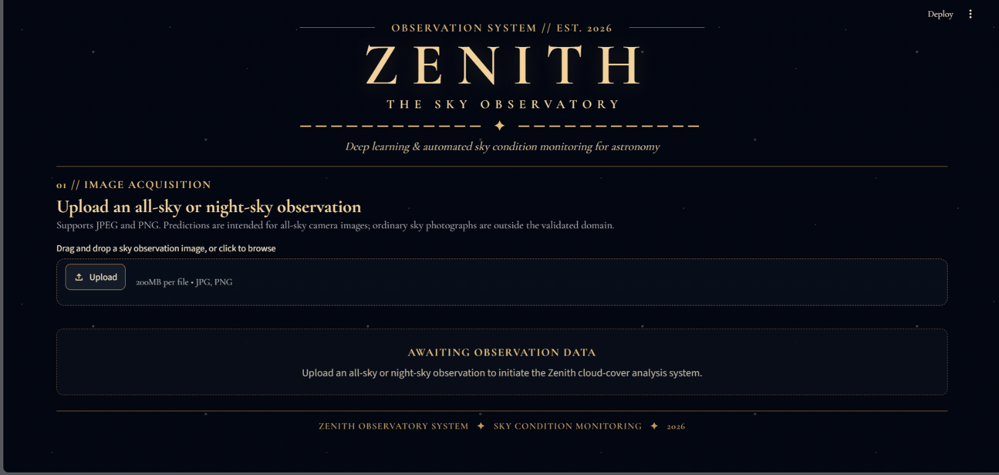
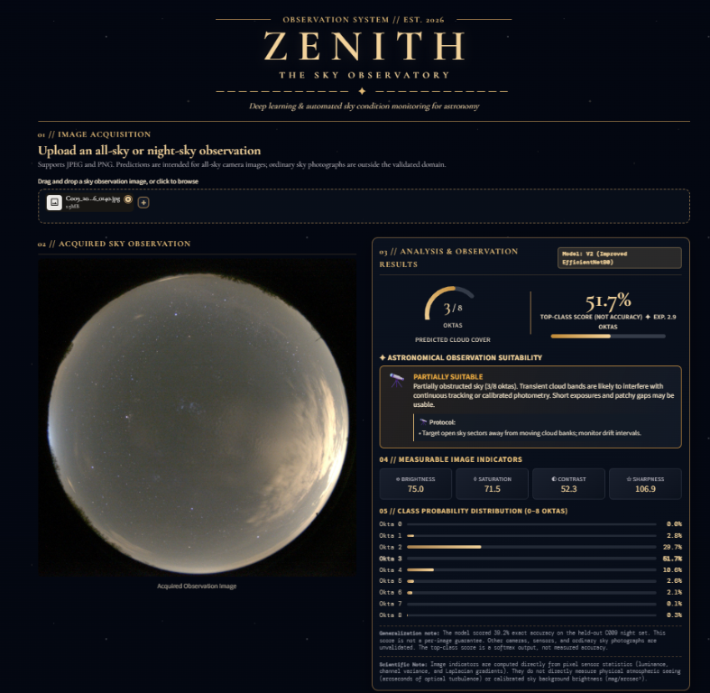
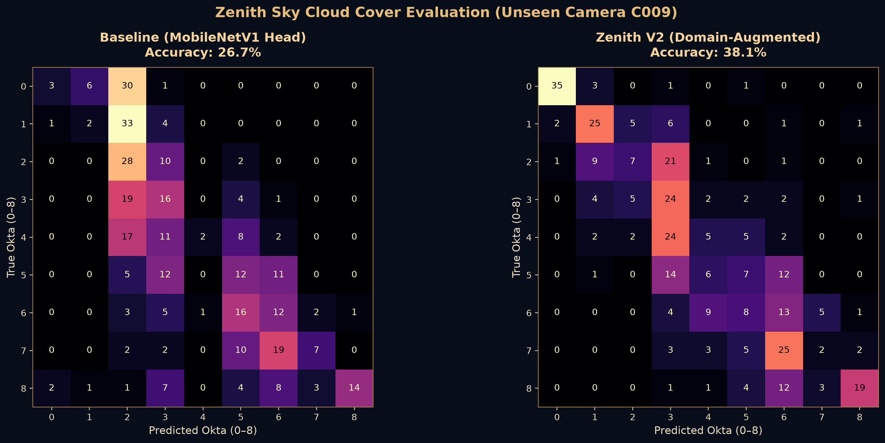
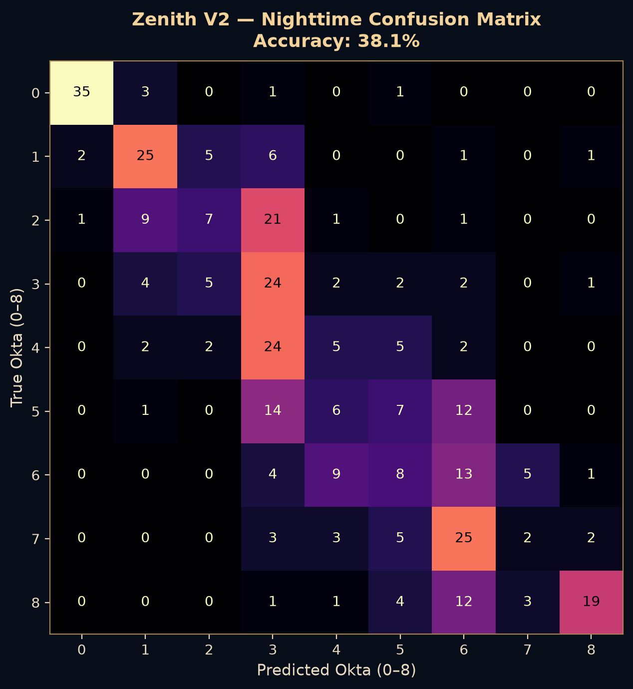

# 🔭 ZENITH: Automatic Sky Condition Monitoring for Astronomy (V2)

Zenith is an intelligent machine learning and computer vision system engineered for astronomical observatories. It automatically monitors all-sky camera feeds, classifies cloud cover across nine discrete okta grades (**0–8 oktas**), extracts measurable optical indicators, and provides transparent observation suitability assessments for amateur and professional astronomers.

## Project Screenshots

The dashboard accepts an all-sky observation and presents its predicted cloud-cover class, confidence, measurable image indicators, and observing-suitability guidance.

| Dashboard | Observation analysis |
| :---: | :---: |
|  |  |

---

## 1. Project Overview & Architectural Evolution

### Why a V2 Model was Necessary
In astronomical sky monitoring, all-sky cameras often suffer from severe domain shift:
- **Diurnal Shift**: Training models on daytime sky feeds biases convolutional neural networks toward daytime features (e.g. associating daylight blue hues with "clear sky" and bright white regions with "clouds"). At night, skies appear dark, amber, or monochrome, causing naive models to collapse.
- **Cross-Camera Generalization**: Different observatories employ varying sensors, exposure timings, dome coatings, and local light-pollution conditions. A model trained on one camera (e.g. camera `C013`) must generalize to unseen cameras and sites (e.g. camera `C009`).
- **Baseline Limitations**: The baseline model (`models/zenith_mobilenetv2.keras`) trained on daytime images without domain-invariance augmentations, achieving only **26.67% accuracy** on the held-out nighttime test set from unseen camera `C009`, with near-zero recall on clear/low-cloud conditions.

### Zenith V2 Solution
Zenith V2 addresses these challenges through:
1. **Efficient Transfer Learning**: EfficientNetB0 backbone with ImageNet pretrained representations, providing a stronger feature extractor while retaining efficient deployment suitability for observatory edge computers.
2. **Domain-Generalizing Data Augmentation**:
   - **Rotational & Reflection Invariance**: Zenith-facing dome images have full rotational symmetry ($360^\circ$ random rotations and horizontal/vertical flips).
   - **Photometric Brightness & Contrast Shifts**: Simulates conditions from dark moonless nights to bright full-moon glare and twilight.
   - **Color & Saturation Invariance**: Random saturation jitter and 30% desaturation/grayscale injection force convolutional filters to learn cloud spatial morphology, edges, and coverage patterns rather than daylight chromaticity.
3. **Nighttime Adaptation Data Integration**: Uses the C005 images in `adaptation_sets/moonless_train_data`, reserving a class-stratified 20% for night-camera validation and oversampling the remainder for training.
4. **Controlled Two-Stage Transfer Learning**:
   - *Phase 1*: Feature extraction with a frozen backbone and trained regularized head (GAP + BatchNormalization + Dense(256) + L2 + Dropout(0.4)).
   - *Phase 2*: Controlled fine-tuning of the top 35 layers with a low learning rate ($7 \times 10^{-5}$) and early stopping.
5. **Continuous Expected Okta Metric**: In addition to discrete classification ($0\text{--}8$), Zenith V2 computes the continuous expected okta value:
   $$\hat{O} = \sum_{c=0}^{8} c \cdot P(c)$$
   providing granular insight when conditions lie between discrete okta steps.

---

### Current Generalization Limits

The current V2 checkpoint scored **39.17% exact accuracy** on the unseen-camera C009 nighttime test set. **76.11%** of predictions were within one okta (MAE: **1.05 oktas**), so many errors are near-neighbor classes, but exact classification remains limited. Daytime accuracy on C009 was **57.50%**. Nighttime recall is still 0% for okta 4 and 5% for okta 7.

The training sources include 5,400 daytime images from C013 and only 180 nighttime images from C005. The pipeline holds out 36 C005 images for checkpoint validation and oversamples the remaining 144; because both sets come from C005, this is not unseen-camera validation. C009 remains held out for final evaluation. This covers only a small number of camera domains. It does not establish accuracy on arbitrary cameras, sensors, or ordinary night-sky photographs, and the displayed softmax score is not a guarantee of correctness. For reliable deployment, collect labeled images from the target camera and evaluate them separately.

### Evaluation visualizations

The evaluation artifacts below compare the baseline and V2 models on the held-out C009 nighttime test set.

| Baseline vs. V2 | Zenith V2 |
| :---: | :---: |
|  |  |

## 2. Project File Structure

The repository includes the Streamlit dashboard, model training and evaluation scripts, and supporting analysis modules:

```
zenith_v2/
├── app.py                    # Streamlit dashboard
├── demonstrate_project.py    # Project demonstration
├── evaluate.py               # Benchmarking and confusion-matrix generation
├── predict.py                # Single-image inference
├── sky_analysis.py           # Image indicators and suitability assessment
├── sky_monitor.py            # Sky-monitoring workflow
├── train.py                  # Model training pipeline
├── docs/images/              # Dashboard screenshots
├── models/                   # Pre-trained model checkpoints
├── reports/                  # Evaluation report, metrics, and visualizations
├── data/GOA-ALLSKY/          # Local training dataset (not tracked by Git)
└── requirements.txt          # Python dependencies
```

The all-sky dataset is approximately 3 GB and is intentionally excluded from this repository. Place it under `data/GOA-ALLSKY/ALLSKY-GOA` before training or running the evaluation scripts.

---

## 3. Measurable Image Indicators vs. Atmospheric Physics

Zenith clearly distinguishes measurable digital camera sensor metrics from actual physical atmospheric properties:

| Image Indicator | Mathematical Formulation | What It Measures | What It Does NOT Measure |
| :--- | :--- | :--- | :--- |
| **Brightness** | Mean HSV Value channel: $\frac{1}{N}\sum V$ | Overall scene luminance / sensor exposure | Calibrated surface brightness (mag/arcsec²) |
| **Saturation** | Mean HSV Saturation channel: $\frac{1}{N}\sum S$ | Color vividness / sky glow tint | Atmospheric ozone or aerosol scattering |
| **Contrast** | Standard deviation of grayscale: $\sigma_{\text{gray}}$ | Dynamic range / cloud-sky separation | Atmospheric extinction coefficient ($k$) |
| **Sharpness** | Laplacian variance: $\text{Var}(\nabla^2 I)$ | High-frequency edge gradient density | Atmospheric seeing in arcseconds (FWHM) |

> [!IMPORTANT]
> Standard RGB camera feeds cannot directly measure atmospheric seeing (sub-arcsecond wavefront turbulence) or light pollution levels without dedicated physical instruments (such as a Differential Image Motion Monitor [DIMM] or a Sky Quality Meter [SQM]). Zenith provides heuristic image indicators to assess optical capture viability, not physical seeing forecasts.

---

## 4. Setup and Execution Guide

### Prerequisites
- Python 3.10 to 3.13
- Virtual environment (`.venv`) with packages listed in `requirements.txt`

### 1. Launch the Streamlit Dashboard
```bash
streamlit run app.py
```
Open your browser at `http://localhost:8501`. Upload an all-sky camera image (`.jpg`, `.jpeg`, `.png`) to inspect the cloud condition, a model-derived obstruction map, and observation suitability. Ordinary night-sky photographs can be processed but are outside the model's validated domain. The dashboard also tracks changes across analyzed images, flags notable conditions, lists recent clear observations, and provides downloadable CSV and JSON reports. History is stored locally in `reports/sky_observation_history.json` (up to 500 observations).

Potential clear-sky start times are short-term extrapolations from at least three observations spanning 15 minutes; they are not weather forecasts. Observation timestamps reflect when images are analyzed, not necessarily when they were captured. The tile obstruction map is a localized model estimate and may be less reliable than the full-image prediction.

### 2. Run Model Training (V2)
```bash
python train.py
```
Executes Stage 1 (head training) and Stage 2 (controlled fine-tuning), saving the best checkpoint to `models/zenith_v2.keras`.

### 3. Run Benchmark Evaluation
```bash
python evaluate.py
```
Evaluates both the Baseline and V2 models on the held-out test dataset from unseen camera `C009`, generates confusion matrices, and writes `reports/model_evaluation.md`.

### 4. Single-Image CLI Inference
```bash
python predict.py test.jpg
```

---

## 5. License & Attribution
Developed for astronomical observatory sky condition monitoring and educational research.
Uses the **GOA-ALLSKY** ground-based all-sky dataset.
